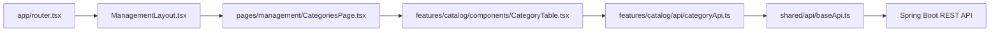

# AQS Frontend – Package Structure

Tài liệu này mô tả cấu trúc package đề xuất cho mã nguồn Frontend của AquaSuite, trách nhiệm của từng khu vực và quy tắc tổ chức code thống nhất trong nhóm.

## 1. Cấu trúc tổng thể

```text
src/                                    # Mã nguồn Frontend AquaSuite
│
├── app/                                # Cấu hình và khởi tạo toàn bộ ứng dụng
│   ├── App.tsx                         # Component gốc của ứng dụng React
│   ├── router.tsx                      # Khai báo URL, điều hướng và bảo vệ route
│   ├── providers.tsx                   # Khai báo các Provider dùng chung
│   └── store.ts                        # Cấu hình Redux Store và RTK Query
│
├── assets/                             # Tài nguyên tĩnh được import trong mã nguồn
│   ├── images/                         # Logo, banner, ảnh nền và ảnh placeholder
│   ├── icons/                          # Icon SVG, PNG riêng của ứng dụng
│   ├── fonts/                          # Font chữ lưu trữ cục bộ
│   └── styles/                         # Style tài nguyên dùng chung nếu cần
│
├── layouts/                            # Bố cục giao diện dùng chung
│   ├── SalesLayout.tsx                 # Bố cục trang bán hàng cho khách hàng
│   ├── ManagementLayout.tsx            # Bố cục trang quản lý cho nhân viên/chủ shop
│   ├── AuthLayout.tsx                  # Bố cục trang đăng nhập và xác thực
│   └── index.ts                        # Export các Layout để sử dụng
│
├── pages/                              # Các màn hình tương ứng với URL
│   │
│   ├── sales/                          # Nhóm trang mua hàng dành cho khách hàng
│   │   ├── HomePage.tsx                # Trang chủ cửa hàng
│   │   ├── ProductsPage.tsx            # Trang danh sách sản phẩm
│   │   ├── ProductDetailPage.tsx       # Trang chi tiết sản phẩm
│   │   ├── CartPage.tsx                # Trang giỏ hàng
│   │   ├── CheckoutPage.tsx            # Trang đặt hàng và chọn phương thức thanh toán
│   │   ├── MyOrdersPage.tsx            # Danh sách đơn hàng của khách
│   │   └── OrderDetailPage.tsx         # Chi tiết và trạng thái đơn hàng
│   │
│   ├── management/                     # Nhóm trang quản trị và vận hành cửa hàng
│   │   ├── DashboardPage.tsx           # Trang tổng quan hoạt động kinh doanh
│   │   ├── ProductsPage.tsx            # Trang quản lý sản phẩm
│   │   ├── CategoriesPage.tsx          # Trang quản lý danh mục sản phẩm
│   │   ├── BrandsPage.tsx              # Trang quản lý thương hiệu
│   │   ├── CustomersPage.tsx           # Trang quản lý thông tin khách hàng
│   │   ├── OrdersPage.tsx              # Trang quản lý đơn bán hàng
│   │   ├── InventoryPage.tsx           # Trang quản lý tồn kho
│   │   ├── PaymentsPage.tsx            # Trang quản lý thanh toán và công nợ
│   │   ├── UsersPage.tsx               # Trang quản lý tài khoản người dùng
│   │   ├── RolesPage.tsx               # Trang quản lý vai trò
│   │   └── PermissionsPage.tsx         # Trang quản lý quyền truy cập
│   │
│   ├── auth/                           # Nhóm trang xác thực người dùng
│   │   ├── LoginPage.tsx               # Trang đăng nhập
│   │   ├── ForgotPasswordPage.tsx      # Trang yêu cầu khôi phục mật khẩu
│   │   └── ResetPasswordPage.tsx       # Trang đặt lại mật khẩu
│   │
│   ├── NotFoundPage.tsx                # Trang lỗi 404: Không tìm thấy URL
│   └── NotForbidden.tsx                # Trang lỗi 403: Không có quyền truy cập
│
├── features/                           # Các module chức năng theo nghiệp vụ
│   ├── iam/                            # Xác thực, tài khoản, vai trò và phân quyền
│   ├── catalog/                        # Sản phẩm, danh mục, thương hiệu, biến thể
│   ├── crm/                            # Khách hàng, địa chỉ và dự án khách hàng
│   ├── sales/                          # Giỏ hàng, báo giá và đơn bán hàng
│   ├── inventory/                      # Tồn kho, nhập hàng và kiểm kê
│   ├── fulfillment/                    # Xuất kho, điều phối và giao hàng
│   ├── servicedesk/                    # Bảo hành và công việc kỹ thuật
│   ├── finance/                        # Thanh toán, công nợ và đối soát
│   ├── intelligence/                   # Dashboard, báo cáo và thống kê
│   ├── audit/                          # Nhật ký hoạt động và lịch sử thay đổi
│   └── aiadvisor/                      # Tư vấn sản phẩm bằng AI
│
└── shared/                             # Thành phần kỹ thuật dùng chung
    │
    ├── api/                            # Hạ tầng giao tiếp REST API với Backend
    │   ├── baseApi.ts                  # Cấu hình base URL và RTK Query API
    │   ├── reauthBaseQuery.ts          # Xử lý refresh token khi hết hạn
    │   ├── apiError.ts                 # Chuẩn hóa và xử lý lỗi API
    │   └── types.ts                    # Kiểu dữ liệu chung của API
    │
    ├── ui/                             # Component UI dùng chung: Button, Modal, Table
    ├── hooks/                          # React Hook dùng chung
    ├── lib/                            # Hàm tiện ích: format, date, validation
    ├── config/                         # Cấu hình môi trường, route, constants
    └── types/                          # Kiểu dữ liệu TypeScript dùng chung
```

## 2. Cấu trúc bên trong một feature

Để nhóm code thống nhất, sử dụng `catalog` làm mẫu cho các feature khác.

```text
features/
└── catalog/                            # Module quản lý danh mục sản phẩm
    │
    ├── api/                            # Định nghĩa các API của Catalog
    │   ├── categoryApi.ts              # API CRUD danh mục
    │   └── brandApi.ts                 # API CRUD thương hiệu
    │
    ├── components/                     # Component giao diện riêng của Catalog
    │   ├── CategoryTable.tsx           # Bảng danh sách danh mục
    │   ├── CategoryForm.tsx            # Form tạo/sửa danh mục
    │   ├── BrandTable.tsx              # Bảng danh sách thương hiệu
    │   └── BrandForm.tsx               # Form tạo/sửa thương hiệu
    │
    ├── hooks/                          # Logic React riêng của Catalog
    │   └── useCategoryFilters.ts       # Quản lý tìm kiếm, lọc danh mục
    │
    ├── schemas/                        # Quy tắc kiểm tra dữ liệu đầu vào
    │   ├── category.schema.ts          # Validate dữ liệu danh mục
    │   └── brand.schema.ts             # Validate dữ liệu thương hiệu
    │
    ├── types/                          # Định nghĩa TypeScript type/interface
    │   ├── category.types.ts           # Kiểu dữ liệu danh mục
    │   └── brand.types.ts              # Kiểu dữ liệu thương hiệu
    │
    └── index.ts                        # Public exports của module Catalog
```

Nếu một feature cần quản lý trạng thái phía client phức tạp, có thể bổ sung thư mục `model/` để chứa Redux slice và selectors. Không bắt buộc tạo `model/` cho tất cả feature, đặc biệt khi dữ liệu server đã được RTK Query quản lý.

## 3. Quy tắc dành cho cả nhóm khi code

| Quy tắc | Giải thích |
| --- | --- |
| `pages` chỉ tổ chức màn hình | Không đặt toàn bộ CRUD, gọi API hoặc business logic phức tạp trong Page. |
| `features` chứa chức năng nghiệp vụ | Component, API, hook và schema của nghiệp vụ nào thì thuộc feature đó. |
| `assets` chứa tài nguyên được import | Dùng cho logo, icon, font và ảnh giao diện được Vite xử lý khi build. |
| `shared` chỉ chứa code dùng chung | Không đưa logic đặc thù như `CategoryForm` vào `shared/ui`. |
| `layouts` chỉ quản lý bố cục | Chứa Header, Sidebar, Footer và Outlet; không xử lý nghiệp vụ CRUD. |
| `app` cấu hình toàn hệ thống | Chứa Router, Redux Store, Provider và phần khởi tạo ứng dụng. |
| Không import xuyên module tùy tiện | Feature khác chỉ sử dụng public exports của module khi cần. |
| Không tạo circular dependency | `shared` không được import ngược từ `features`; các module không phụ thuộc vòng tròn. |

### Phân biệt `src/assets` và `public`

- `src/assets/` chứa tài nguyên được import trực tiếp trong mã nguồn và được Vite xử lý khi build.
- `public/` chứa tài nguyên cần giữ nguyên tên hoặc được truy cập bằng URL cố định, ví dụ `/favicon.ico`.
- Ảnh sản phẩm thực tế lấy từ Backend hoặc dịch vụ lưu trữ không đặt trong `src/assets/`. Thư mục này chỉ nên chứa tài nguyên thuộc giao diện ứng dụng như logo, icon, banner mặc định và ảnh placeholder.

## 4. Ví dụ luồng xử lý thực tế

Khi nhân viên truy cập trang **Quản lý danh mục**, luồng trách nhiệm của các thành phần như sau:



Đây là luồng minh họa trách nhiệm của các thành phần, không phải chuỗi import bắt buộc của React. Khi thực thi, component có thể sử dụng hook do RTK Query sinh ra để lấy dữ liệu.
